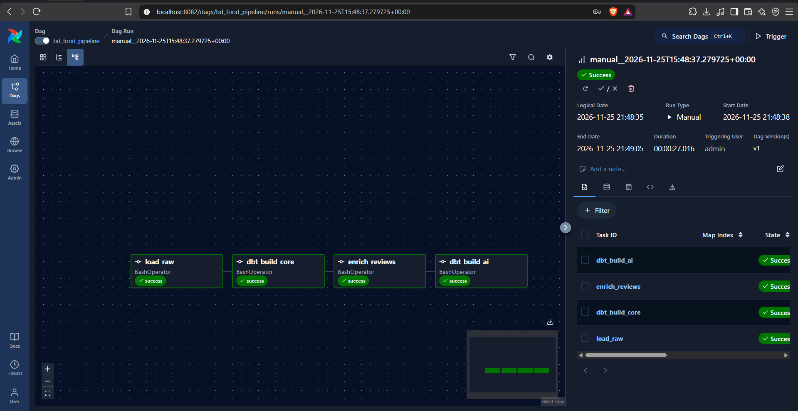
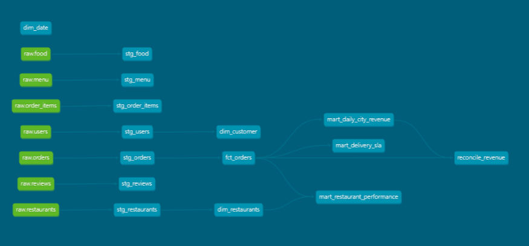
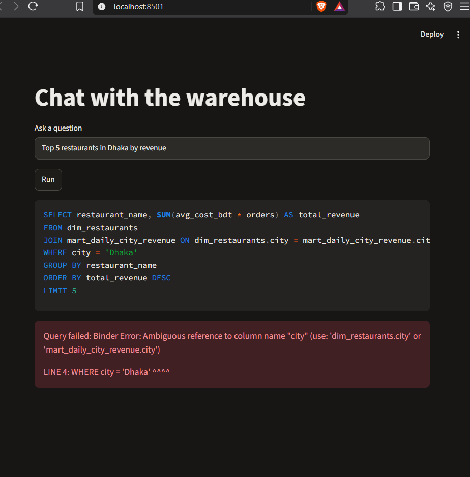
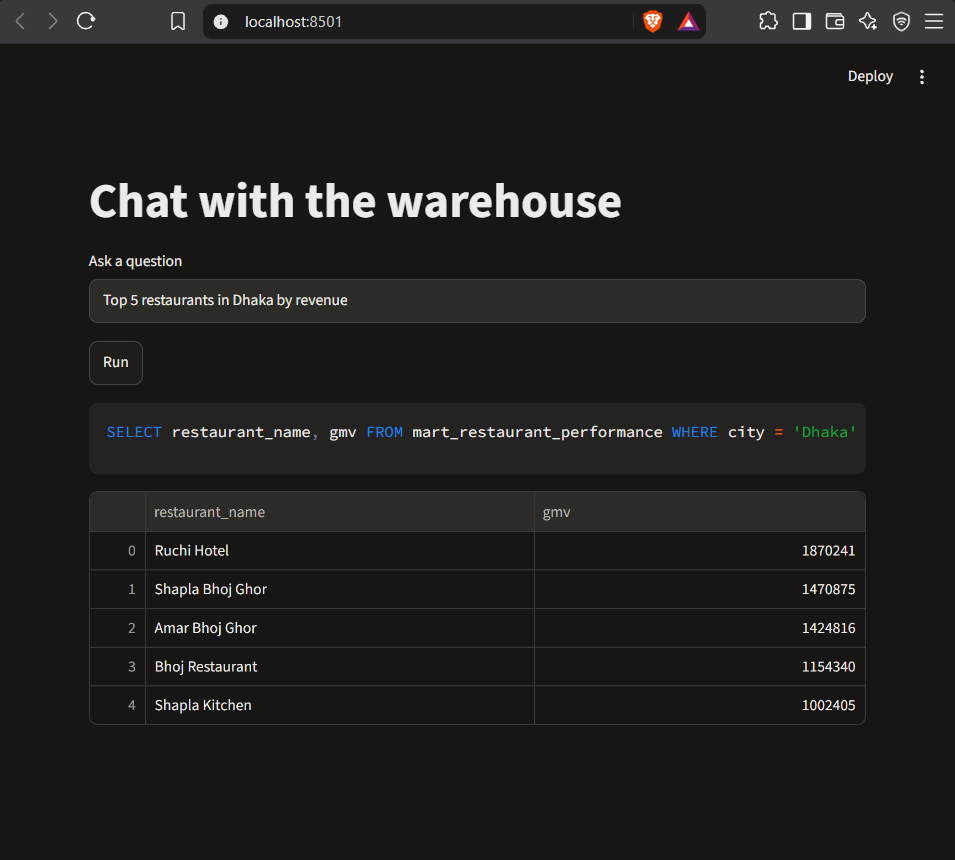
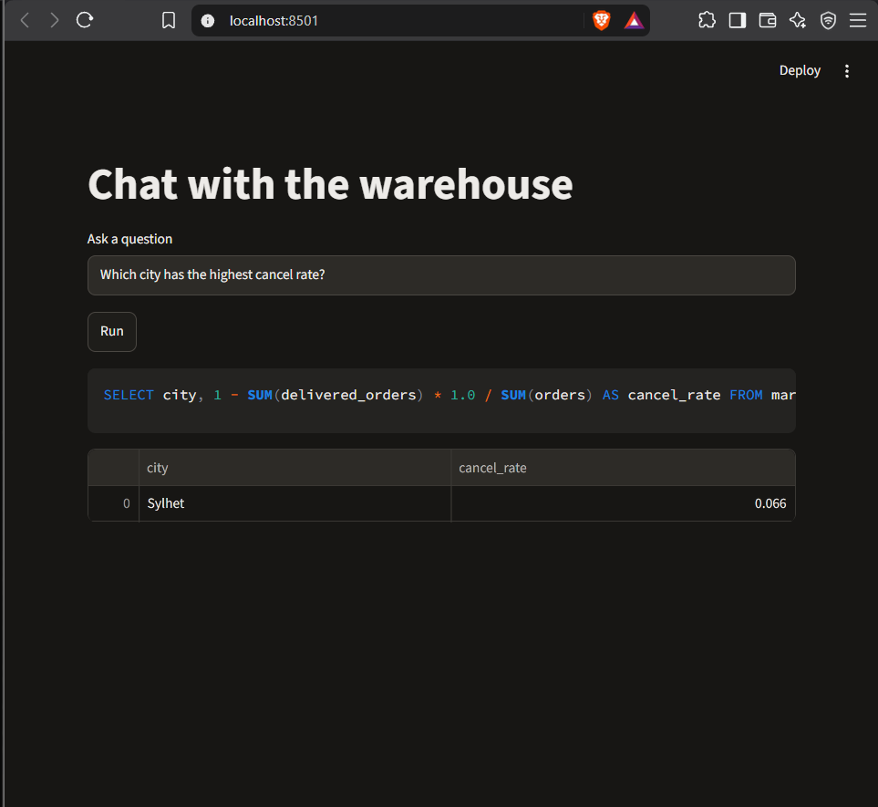
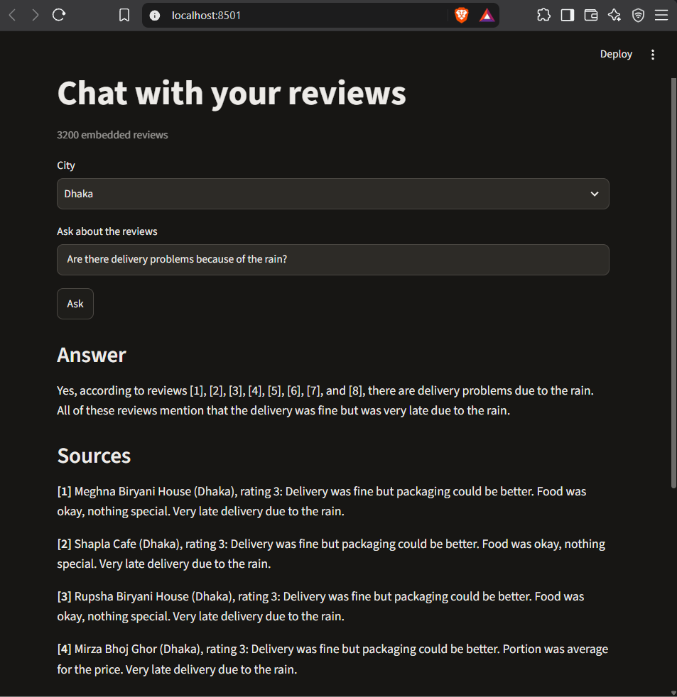
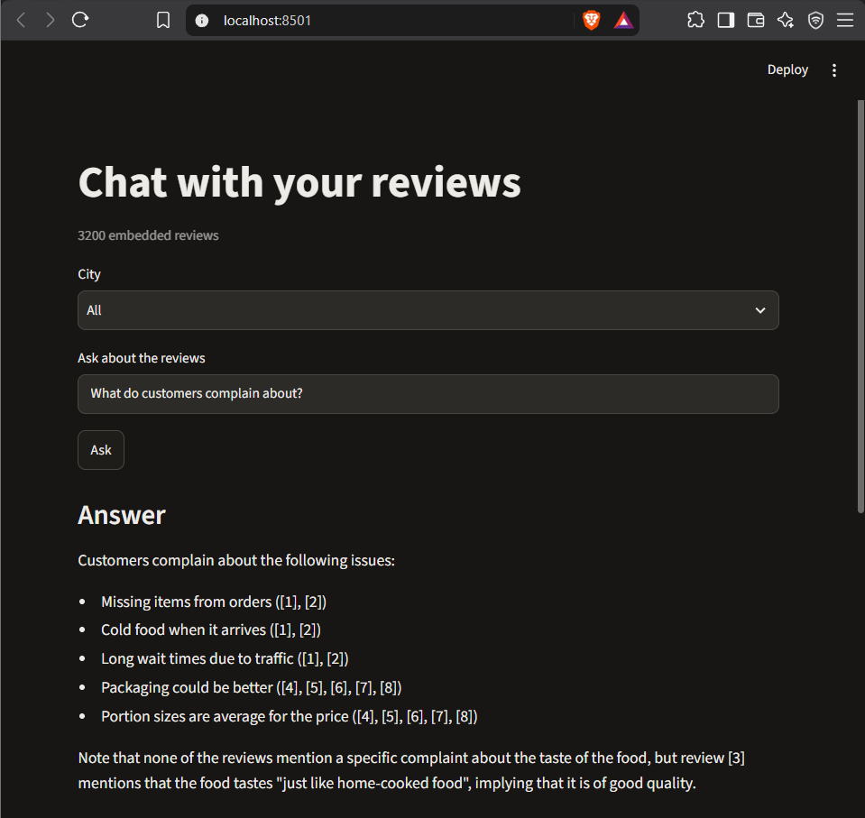
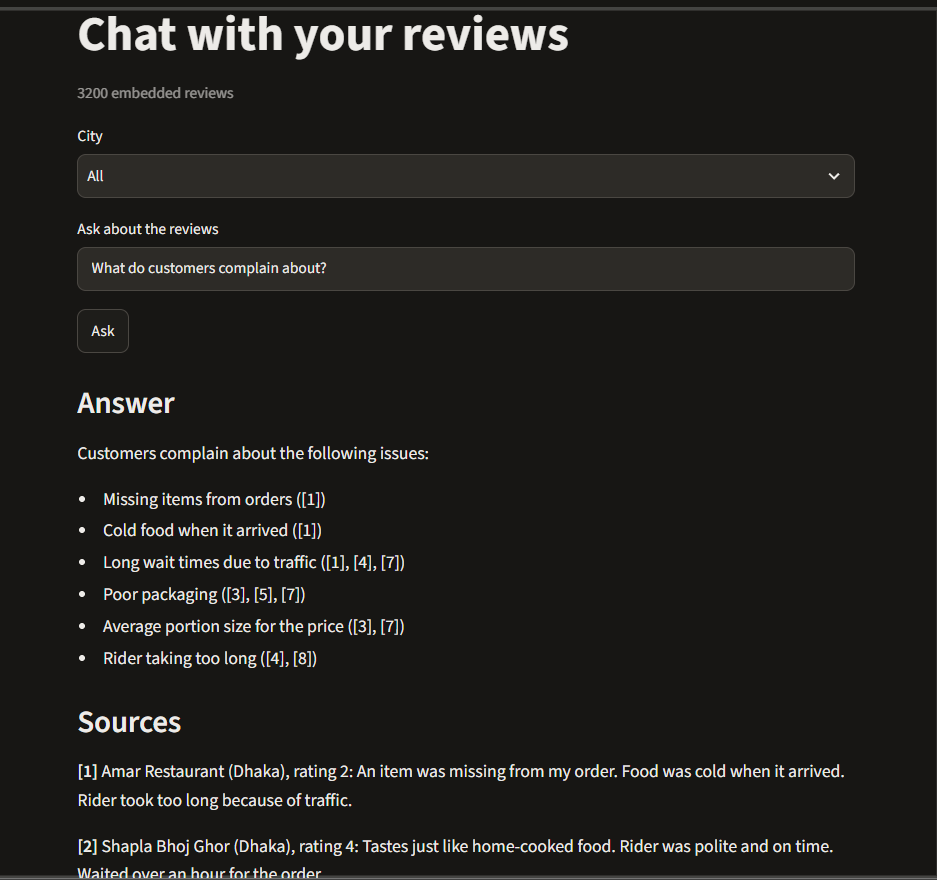

# Dhaka Food Delivery Data Platform

An end-to-end batch data pipeline on a synthetic Bangladesh food-delivery dataset: raw CSVs → DuckDB → dbt (staging, dimensions, facts, marts) → Airflow, with a local-LLM enrichment step that turns free-text reviews into structured sentiment and topic columns.


## Architecture

CSV files → DuckDB `raw` schema → dbt staging views → dbt gold tables → LLM enrichment → AI mart, orchestrated by one Airflow DAG:

`load_raw → dbt_build_core → enrich_reviews → dbt_build_ai`

## Highlights

- **Bangladeshi dataset.** Wrote a Python generator (`scripts/generate_bd_data.py`) for 200,000 orders, 18,745 reviews, 3,000 restaurants and 20,000 users across Dhaka, Chattogram, Sylhet, Khulna and Rajshahi, with BDT prices, bKash/Nagad/cash-on-delivery payments, lunch and dinner peaks, and monsoon delivery delays.
- **Fully local, free stack.** DuckDB handles storage and transformation, so anyone can run it at no cost.
- **Local LLM.** Llama 3.2 3B via Ollama classifies review sentiment and topic. Output is idempotent, so reviews are never processed twice.
- **My own models.** Incremental `fct_orders`; marts for daily city revenue (7-day rolling GMV window function), restaurant ranking per city, delivery SLA (p50/p90) and review insights.
- **Data quality.** 19 dbt tests (uniqueness, not-null, relationships, accepted values) plus a custom revenue reconciliation test.

## Run it

```bash
python -m venv .venv && source .venv/Scripts/activate
pip install dbt-duckdb duckdb pandas requests
python scripts/generate_bd_data.py
python scripts/load_raw.py
cd dbt && dbt build --exclude tag:ai --profiles-dir .
```

For the full pipeline: `cd airflow && docker compose up -d --build`, open http://localhost:8082, and trigger `bd_food_pipeline`. Ollama (with `llama3.2:3b`) must be running for the enrichment step.

## Screenshots

**Airflow DAG**



**dbt lineage**



## Challenges and lessons

- DuckDB misdetected the CSV header on a one-column table; fixed by declaring `header=true` explicitly.
- Installing dbt next to Airflow broke Airflow's dependencies; solved by putting dbt in its own virtualenv inside the Docker image.
- A shared dbt cache between Windows and the Linux container caused parse errors; disabled partial parsing.
- Docker filled the system drive; learned to monitor disk usage and clean images and build cache.
- The 3B model assigns one topic per review, so multi-topic reviews are only partly captured. A larger model or multi-label output would improve this.

## Limitations

The data is synthetic, so findings illustrate the pipeline, not real-world behaviour. The LLM labels were spot-checked, not formally evaluated.

## Chat with the warehouse

`ai/text_to_sql.py` is a Streamlit app that turns English questions into DuckDB SQL using a local model (qwen2.5-coder). It shows the generated SQL, only allows a single read-only `SELECT`, and retries once with the error message if the query fails. Run it with `streamlit run ai/text_to_sql.py`.

**Before schema hints:** the 3B model joined two tables and wrote an ambiguous query that failed.



**After adding table descriptions, rules and examples to the prompt:** correct answers.




Known limitation: small models can pick the wrong table. For example, "average delivery time per city" averages per-restaurant averages instead of weighting by orders.

## Chat with your reviews (RAG)

`ai/embed_reviews.py` embeds review text with a local model (nomic-embed-text) into DuckDB (3,200 reviews embedded). `ai/rag_chat.py` embeds the question, retrieves similar reviews by cosine similarity (optionally filtered by city), removes near-duplicate reviews, and asks a local Llama model to answer using only those reviews, with numbered sources.

Run it with `python ai/embed_reviews.py`, then `streamlit run ai/rag_chat.py`.

Filtering by city (Dhaka only):



**A retrieval issue I found:** the top matches were near-duplicate reviews (sometimes the same sentences in a different order), so one review was repeated and the answer was skewed. I added order-insensitive deduplication and a wider candidate pool, which gave varied sources.

Before (duplicate sources):



After (distinct sources):



Limitations: the reviews are synthetic and built from a small set of sentence templates, so results are less varied than real reviews. Small local models can also overstate conclusions, so the app shows numbered sources for checking.
